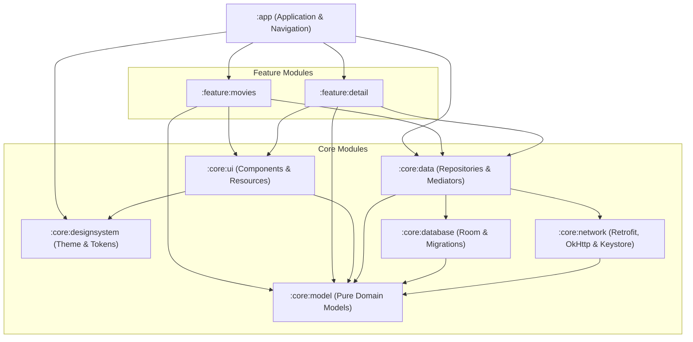
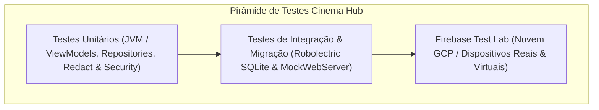

# 🎬 Cinema Hub — Android Architecture & Engineering Showcase

[](https://www.android.com)
[](https://kotlinlang.org)
[](https://developer.android.com)
[](https://developer.android.com)
[](https://developer.android.com/jetpack/compose)
[](https://developer.android.com/topic/architecture)
[](https://github.com/AdautoEC/marvel-comics-app/actions)
[](LICENSE)

O **Cinema Hub** é um aplicativo Android nativo moderno desenvolvido para servir como **referência arquitetural de alto nível**, demonstrando padrões de engenharia de software de nível de produção (Tier-1), segurança em profundidade, performance rigorosa em Jetpack Compose, persistência reativa com Room, sincronização em nuvem e automação completa de CI/CD com Firebase Test Lab e App Distribution.

---

## 📑 Sumário

1. [Visão Geral & Destaques de Engenharia](#-visão-geral--destaques-de-engenharia)
2. [Arquitetura Modular](#-arquitetura-modular)
3. [Decisões Arquiteturais & Design Patterns](#-decisões-arquiteturais--design-patterns)
4. [Engenharia de Segurança em Profundidade](#-engenharia-de-segurança-em-profundidade)
5. [Otimizações de Performance em Jetpack Compose](#-otimizações-de-performance-em-jetpack-compose)
6. [Estratégia Abrangente de Testes](#-estratégia-abrangente-de-testes)
7. [Pipeline de CI/CD & Automação de Release](#-pipeline-de-cicd--automação-de-release)
8. [Stack de Tecnologias & Bibliotecas](#-stack-de-tecnologias--bibliotecas)
9. [Instruções de Compilação & Execução](#-instruções-de-compilação--execução)

---

## 🌟 Visão Geral & Destaques de Engenharia

O projeto integra a **API v3 do The Movie Database (TMDB)**, oferecendo navegação por categorias (*Populares*, *Mais Votados*, *Favoritos* e *Quero Assistir*), busca dinâmica com debounce, visualização de detalhes, controle de favoritos/watchlist e autenticação OAuth v3 com persistência criptografada.

### Principais Inovações Técnicas:
- **0ms Reactive Heart Updates:** Substituição de 40 consultas N+1 por página por projeções SQL `LEFT JOIN` no Room com `InvalidationTracker`, permitindo atualização visual imediata de corações ao favoritar sem reload ou troca de abas.
- **Coexistência de Categorias sem Sobrescrita:** Chave primária composta `primaryKeys = ["id", "category"]` com migrações SQLite determinísticas (`MIGRATION_2_3`), preservando dados do usuário e cache.
- **Autenticação OAuth sem Senhas com Defesa CSRF:** Handshake via AndroidX Custom Tabs BottomSheet com verificação estrita de `pendingRequestToken`, TTL de 10 minutos e proteção contra replay attacks.
- **Isolamento de Credenciais de Rede:** Redes de imagem (Coil) operam em instâncias isoladas de `OkHttpClient`, impedindo o vazamento de tokens e API keys para CDNs externas.
- **Fail-Closed Release Signing:** Builds de release e pipelines de CD falham explicitamente se credenciais de assinatura de produção estiverem ausentes, impedindo a publicação acidental de APKs debug em produção.

---

## 🏛 Arquitetura Modular

O projeto adota **Clean Architecture modularizada por camadas e features**, garantindo baixo acoplamento, alta coesão e tempos de compilação incrementais otimizados.



### Responsabilidades por Módulo

| Módulo | Tipo | Responsabilidade Principal |
|---|---|---|
| [`:app`](app) | Android App | Ponto de entrada (`CinemaApp`), Grafo de Injeção de Dependência Hilt raiz, roteamento (`CinemaNavHost`), interceptação de Deep Links (`cinemahub://tmdb-callback`), políticas de assinatura e minificação R8. |
| [`:core:model`](core/model) | Pure Kotlin/Android | Modelos puros de domínio (`MovieSummary`, `MovieDetail`, `AccountProfile`, `SessionState`, `Outcome<T>`, `DomainError`). Zero dependências de UI ou bancos de dados para máxima portabilidade. |
| [`:core:database`](core/database) | Android Library | Camada de persistência local com Room SQLite. Entidades (`MovieEntity`, `FavoriteMovieEntity`, `WatchedMovieEntity`), DAOs com projeções `MovieWithUserData`, migrações determinísticas (`MIGRATION_2_3`) com exportação de schema. |
| [`:core:network`](core/network) | Android Library | Camada de comunicação remota. Retrofit 2, Sandwich `ApiResponse`, interceptadores (`TmdbAuthInterceptor`, `RedactingHttpLoggingInterceptor`), Android Keystore com AES-256-GCM para tokens de sessão, e isolamento de clientes HTTP para imagens. |
| [`:core:data`](core/data) | Android Library | Repositórios (`MoviesRepositoryImpl`, `AuthRepositoryImpl`), Paging 3 `RemoteMediator`, monitoramento de conectividade em tempo real (`ConnectivityManagerNetworkMonitor`), sincronização bidirecional aditiva ($Local \cup Remote$). |
| [`:core:ui`](core/ui) | Android Library | Componentes Compose reutilizáveis (`MovieCard`, `OfflineBanner`, `ErrorState`, `MovieCover`, `Shimmer`), otimizações de recomposição, utilitários de Custom Tabs e extensões de internacionalização (`MovieCategoryExtensions`). |
| [`:core:designsystem`](core/designsystem) | Android Library | Fundações visuais: Material 3 Theme, paleta de cores temática escura, tipografia, espaçamentos, formas e anotações customizadas de preview Compose (`@ThemePreviews`, `@DevicePreviews`). |
| [`:feature:movies`](feature/movies) | Android Library | Tela de listagem em grade, tabs de categorias, busca in-tab reativa com debounce (`flatMapLatest`), PullToRefresh orientado a `LoadState`, User Session Pill (Guest vs Authenticated) e banners de sincronização. |
| [`:feature:detail`](feature/detail) | Android Library | Tela de detalhes do filme com sinopse, poster em alta resolução, avaliação, data de lançamento e toggles otimistas imediatos de favoritos e watchlist. |
| [`:benchmark`](benchmark) | Test / Benchmark | Macrobenchmark do Jetpack para geração de Baseline Profiles visando startup a frio em menos de 1 segundo e renderização a 60/120 FPS. |

---

## 💡 Decisões Arquiteturais & Design Patterns

### 1. Eliminação do Problema de Consulta N+1 via SQL `LEFT JOIN`
- **Problema Anterior:** Para cada página carregada via Paging 3 (20 itens), o mapeamento chamava `favoriteDao.isFavorite(id).first()` e `watchedDao.isWatched(id).first()`, disparando **40 consultas SQLite adicionais por emissão de página**. Além disso, favoritar um item não invalidava a fonte de dados, exigindo que o usuário alternasse de aba para ver o coração atualizado.
- **Solução Implementada:** Criação da projeção [`MovieWithUserData`](core/database/src/main/java/com/adauto/marvel/core/database/model/MovieWithUserData.kt) e consulta SQL agregada no [`MovieDao`](core/database/src/main/java/com/adauto/marvel/core/database/dao/MovieDao.kt):
  ```sql
  SELECT m.*, 
         (f.movieId IS NOT NULL) AS isFavorite, 
         (w.movieId IS NOT NULL) AS isWatched
  FROM movies m
  LEFT JOIN favorite_movies f ON m.id = f.movieId
  LEFT JOIN watched_movies w ON m.id = w.movieId
  WHERE m.category = :category
  ORDER BY m.position ASC
  ```
- **Resultado:** Redução de **40 consultas SQLite para 0 adicionais**. O `InvalidationTracker` do Room rastreia automaticamente as tabelas `favorite_movies` e `watched_movies`. Quando um item é favoritado, o Room invalida o `PagingSource` instantaneamente, atualizando o ícone de coração com **0ms de latência percebida**.

### 2. Chave Primária Composta no Room `(id, category)`
- **Problema Anterior:** `MovieEntity` utilizava apenas `id` como chave primária. Filmes que apareciam simultaneamente em mais de uma categoria (ex: *Populares* e *Mais Votados*) sobrescreviam o registro anterior durante o `@Upsert`, corrompendo a ordenação da categoria anterior.
- **Solução Implementada:** Elevação para chave primária composta:
  ```kotlin
  @Entity(
      tableName = "movies",
      primaryKeys = ["id", "category"],
      indices = [Index(value = ["category", "position"], unique = true)]
  )
  data class MovieEntity(...)
  ```
  Evolução do schema para a versão 3 via [`MIGRATION_2_3`](core/database/src/main/java/com/adauto/marvel/core/database/migrations/DatabaseMigrations.kt) sem uso de `fallbackToDestructiveMigration()`, garantindo preservação de 100% dos dados do usuário.

### 3. Sincronização Bidirecional Aditiva ($Local \cup Remote$)
- **Modo Visitante (Guest):** O usuário pode favoritar e adicionar filmes à sua lista de "Quero Assistir" sem login, persistidos no Room SQLite local.
- **Login com Conta TMDB:** Ao autenticar via OAuth, o [`MoviesRepositoryImpl`](core/data/src/main/java/com/adauto/marvel/core/data/repository/MoviesRepositoryImpl.kt) executa a união aditiva ($Local \cup Remote$):
  1. Baixa os favoritos remotos da nuvem TMDB e insere no Room.
  2. Identifica os favoritos criados localmente em modo offline/visitante e os envia via API para a nuvem TMDB.
  3. Ao deslogar (`logout()`), as credenciais de sessão são revogadas e o cache local do Room é expurgado para proteção de privacidade multi-usuário.

### 4. Padrão Unidirectional Data Flow (UDF / MVI)
Todos os ViewModels seguem o padrão formal UDF com contratos explícitos:
- **`UiState`:** Estado único imutável exposto via `StateFlow` e consumido com `collectAsStateWithLifecycle()`.
- **`UiAction`:** Ações e intenções do usuário disparadas pela View (ex: `CategorySelected`, `FavoriteToggled`, `SearchQueryChanged`).
- **`UiEffect`:** Eventos únicos emitidos via `Channel<UiEffect>` (ex: `OpenAuthUrl`, `ShowSnackbar`).

---

## 🔒 Engenharia de Segurança em Profundidade

O projeto implementa padrões defensivos alinhados aos requisitos do **OWASP Mobile Application Security Verification Standard (MASVS)**:

### 1. Zero Plaintext Passwords & Handshake OAuth v3 Seguro
- O aplicativo **nunca solicita, processa ou armazena senhas de usuários**.
- A autenticação é delegada ao TMDB via AndroidX Custom Tabs em um Bottom Sheet estilizado (`#0F0F14`).
- **Mitigação de CSRF e Replay Attacks:**
  - Ao iniciar o fluxo, um `pendingRequestToken` atômico é registrado em memória com carimbo de tempo.
  - Ao receber o Deep Link de retorno (`cinemahub://tmdb-callback?request_token=...&approved=true`), o token recebido deve corresponder exatamente ao token iniciado localmente e estar dentro da janela de validade de **10 minutos (TTL)**.
  - O token é consumido e invalidado imediatamente (`single-use`), rejeitando tentativas de replay ou callbacks forjados por apps maliciosos com `DomainError.InvalidKey`.

### 2. Criptografia no Android Keystore com AES-256-GCM
- Tokens de sessão (`session_id`) são criptografados pelo [`KeystoreCipher`](core/network/src/main/java/com/adauto/marvel/core/network/security/KeystoreCipher.kt) usando uma chave mestra gerada dentro do hardware seguro do dispositivo (**Android Keystore Provider**):
  - Algoritmo: `AES/GCM/NoPadding` com autenticação de integridade de 128 bits.
  - Os bytes cifrados e o vetor de inicialização (IV) são armazenados no `DataStoreSessionStorage`.
  - Em caso de adulteração ou perda da chave, a recuperação é segura (fail-safe), invalidando a sessão sem causar crash no app.

### 3. Isolamento do Cliente HTTP de Imagens (Coil)
- O cliente de rede principal do TMDB anexa automaticamente `api_key` e cabeçalhos de autenticação.
- Para evitar que esses segredos vazem ao carregar posters de CDNs públicas ou servidores externos, o módulo [`ImageClientModule`](core/network/src/main/java/com/adauto/marvel/core/network/di/ImageClientModule.kt) fornece uma instância isolada de `OkHttpClient` para o Coil:
  - Cache em disco dedicado de 100 MB.
  - **Zero interceptadores de autenticação** anexados à requisição de imagens.

### 4. Mascaramento em Logs de Telemetria (`RedactingHttpLoggingInterceptor`)
- Em builds de desenvolvimento ou testes, os logs de requisições HTTP utilizam o [`RedactingHttpLoggingInterceptor`](core/network/src/main/java/com/adauto/marvel/core/network/telemetry/RedactingHttpLoggingInterceptor.kt), que substitui automaticamente query parameters e headers sensíveis (`api_key`, `session_id`, `apikey`, `hash`, `Authorization`) por `[REDACTED]`.

### 5. Fail-Closed Release Signing no Gradle & CI
- O script [`app/build.gradle.kts`](app/build.gradle.kts) e o workflow de CD adotam a política **fail-closed**:
  - Em pipelines de CD (`CI_RELEASE_BUILD=true` ou tarefas com `bundleRelease`), a ausência do arquivo de keystore ou de senhas lança imediatamente uma `GradleException`, impedindo que artefatos de release sejam publicados acidentalmente assinados com chaves de debug.

---

## ⚡ Otimizações de Performance em Jetpack Compose

### 1. Eliminação de Alocações em Recomposição
No [`MovieCard.kt`](core/ui/src/main/java/com/adauto/marvel/core/ui/component/MovieCard.kt), instâncias de `Brush.verticalGradient(...)` e coleções de `Color` foram promovidas a constantes estáticas de nível superior:
```kotlin
private val MovieCardGradientColors = listOf(
    Color.Transparent,
    MarvelColors.DarkBackground.copy(alpha = 0.75f),
    MarvelColors.DarkBackground.copy(alpha = 0.98f)
)
internal val MovieCardBottomGradient = Brush.verticalGradient(MovieCardGradientColors)
```
Isso impede que milhares de objetos temporários sejam instanciados e descartados pelo Garbage Collector durante a rolagem rápida da grade.

### 2. Reciclagem Otimizada de Slots de Composição (`contentType`)
No [`MovieListScreen.kt`](feature/movies/src/main/java/com/adauto/marvel/feature/movies/MovieListScreen.kt), o `LazyVerticalGrid` utiliza `contentType`:
```kotlin
items(
    count = movies.itemCount,
    key = movies.itemKey { it.id },
    contentType = movies.itemContentType { "MovieCard" }
) { index -> ... }
```
Permite que o Compose reutilize os slots estruturais de layout dos cartões durante o scroll, minimizando o tempo de layout e eliminando "jank" (frames perdidos).

---

## 🧪 Estratégia Abrangente de Testes

O projeto adota uma pirâmide de testes abrangente cobrindo camadas de domínio, dados, persistência local e UI com suítes ativas de testes unitários e de integração. As métricas e gates formais de cobertura de código são estabelecidos via Kover na Fase 3 do projeto:



### Tipos de Testes Implementados:

1. **Testes Unitários de Domínio & ViewModels (JVM Puro):**
   - Execução ultra-rápida utilizando `kotlinx-coroutines-test` (`StandardTestDispatcher`), `Turbine` para asserções de StateFlow, `Google Truth` e `MockK`.
   - Cobertura de cenários de sucesso, erro de rede, debounce de pesquisa, pull-to-refresh e transições offline.
2. **Testes de Banco de Dados & Migração (Robolectric + Room Testing):**
   - Validação da `MIGRATION_2_3`: cria um banco de dados SQLite na versão 2 em memória, migra para a versão 3 e valida que nenhuma linha de favoritos ou histórico é perdida.
   - Validação da chave composta `(id, category)` garantindo que o mesmo ID de filme coexiste em categorias diferentes.
   - Validação do SQL `LEFT JOIN` e emissão reativa em [`MovieDaoReactiveJoinTest.kt`](core/database/src/test/java/com/adauto/marvel/core/database/dao/MovieDaoReactiveJoinTest.kt).
3. **Testes de Rede & Segurança (MockWebServer & Android Keystore):**
   - [`KeystoreCipherTest.kt`](core/network/src/androidTest/java/com/adauto/marvel/core/network/security/KeystoreCipherTest.kt): criptografia e decriptografia AES-256-GCM.
   - [`RedactingHttpLoggingInterceptorTest.kt`](core/network/src/test/java/com/adauto/marvel/core/network/telemetry/RedactingHttpLoggingInterceptorTest.kt): mascaramento de credenciais TMDB.
   - [`AuthRepositoryTest.kt`](core/data/src/test/java/com/adauto/marvel/core/data/repository/AuthRepositoryTest.kt): validação de CSRF, expiração de 10 min e bloqueio de token replay.
4. **Testes de UI & Previews em Compose:**
   - Testes com `ComposeContentTestRule` usando tags semânticas (`Modifier.testTag`).
   - Cobertura de catálogo com `@ThemePreviews` e `@DevicePreviews` via `PreviewParameterProvider`.
5. **Testes Instrumentados Remotos na Nuvem (Firebase Test Lab):**
   - Executados via Google Cloud SDK (`gcloud firebase test android run`) em dispositivos físicos e virtuais com locale `pt_BR`, failover automático contra estouro de cotas e download dos resultados XML para o CI.

---

## 🚀 Pipeline de CI/CD & Automação de Release

O repositório é equipado com automação completa via **GitHub Actions** em dois fluxos complementares:

### 1. `PR Verification` (`.github/workflows/pr.yml`)
- Disparado em pull requests para a branch `main`.
- Executa em paralelo:
  - Análise estática de código com **Detekt** (0 code smells tolerados).
  - Verificação de Lint do Android (**Android Lint**).
  - Execução de toda a suíte de testes unitários JVM (`testDebugUnitTest`).
  - Compilação dos APKs debug e de release para validação de regras de ProGuard/R8.

### 2. `Main CD Pipeline` (`.github/workflows/main-cd.yml`)
- Disparado automaticamente no merge para `main`.
- **Job 1 (Verify):** Verificação de integridade e testes.
- **Job 2 (Build & Sign):** Decodifica keystore de release a partir de secrets base64, compila APK minificado com R8, gera o Android App Bundle (`.aab`) com `versionCode` dinâmico baseado em `${{ github.run_number }}` e arquiva mapeamentos de ProGuard.
- **Job 3 (Firebase Test Lab):** Executa testes instrumentados no Google Cloud em dispositivos Android virtuais/físicos.
- **Job 4 (Deploy & Release):**
  - Faz upload do APK para o **Firebase App Distribution** para o grupo de testadores (`testers`).
  - Cria tag Git anotada (ex: `v1.0.0-build.24`).
  - Publica um **GitHub Release** oficial anexando APK, AAB e mapeamentos R8.

---

## 🛠 Stack de Tecnologias & Bibliotecas

| Categoria | Tecnologias Utilizadas |
|---|---|
| **Linguagem & Runtime** | Kotlin 2.0.21, Java 17, Coroutines & Flow 1.9.0 |
| **Interface (UI)** | Jetpack Compose BOM 2024.10.00, Material 3, Compose Navigation 2.8.3, Coil 2.7.0 |
| **Persistência Local** | AndroidX Room 2.6.1 (SQLite, InvalidationTracker, KSP), DataStore Preferences |
| **Comunicação Remota** | Retrofit 2.11.0, OkHttp 4.12.0, Sandwich 2.0.10, KotlinX Serialization 1.7.3 |
| **Paginação & Listas** | AndroidX Paging 3 (Paging 3.3.2, Paging Compose, RemoteMediator) |
| **Injeção de Dependências** | Dagger Hilt 2.52 |
| **Segurança & Criptografia** | Android Keystore Provider, AES-256-GCM, Custom Tabs 1.8.0 |
| **Qualidade & Análise** | Detekt 1.23.7, Android Lint |
| **Testes** | JUnit 4, Robolectric 4.14.1, MockK 1.13.13, Google Truth 1.4.4, Turbine 1.2.0 |
| **Cloud & DevOps** | Firebase App Distribution, Firebase Test Lab, Google Cloud SDK, GitHub Actions |

---

## 💻 Instruções de Compilação & Execução

### Pré-requisitos
- **Android Studio:** Ladybug (2024.2.1) ou superior.
- **JDK:** OpenJDK 17.
- **Android SDK:** Compile SDK 35, Build Tools 35.0.0.

### 1. Clonar o Repositório
```bash
git clone https://github.com/AdautoEC/marvel-comics-app.git
cd marvel-comics-app
```

### 2. Configurar Chaves de API
Crie ou edite o arquivo `local.properties` na raiz do projeto com sua chave gratuita do [TMDB](https://www.themoviedb.org/settings/api):
```properties
tmdb.api.key=SUA_TMDB_API_KEY_AQUI
tmdb.read.access.token=SEU_TMDB_READ_ACCESS_TOKEN_AQUI
```

### 3. Comandos Úteis do Gradle

```bash
# Executar análise estática com Detekt (todas as camadas)
./gradlew detekt

# Executar todas as suítes de testes unitários e de integração
./gradlew testDebugUnitTest

# Executar verificação de lint
./gradlew lintDebug

# Compilar APK de Debug
./gradlew assembleDebug

# Compilar APK e Bundle de Release minificados com R8
./gradlew assembleRelease bundleRelease

# Compilar APKs de Testes Instrumentados para Test Lab
./gradlew :app:assembleDebug :app:assembleDebugAndroidTest
```

---

## 📄 Licença

Distribuído sob a licença Apache 2.0. Consulte [`LICENSE`](LICENSE) para mais detalhes.
